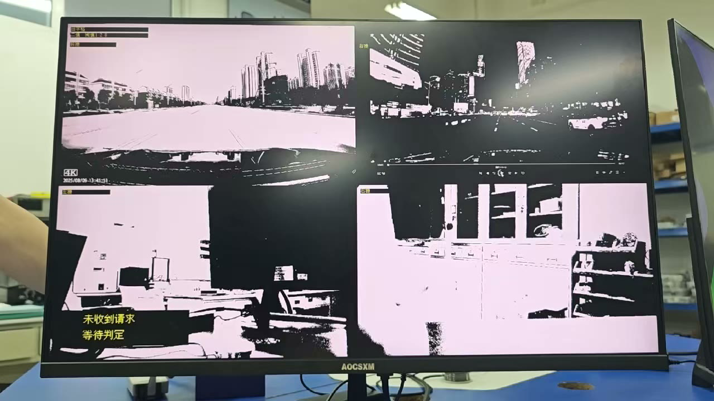
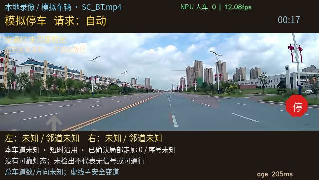
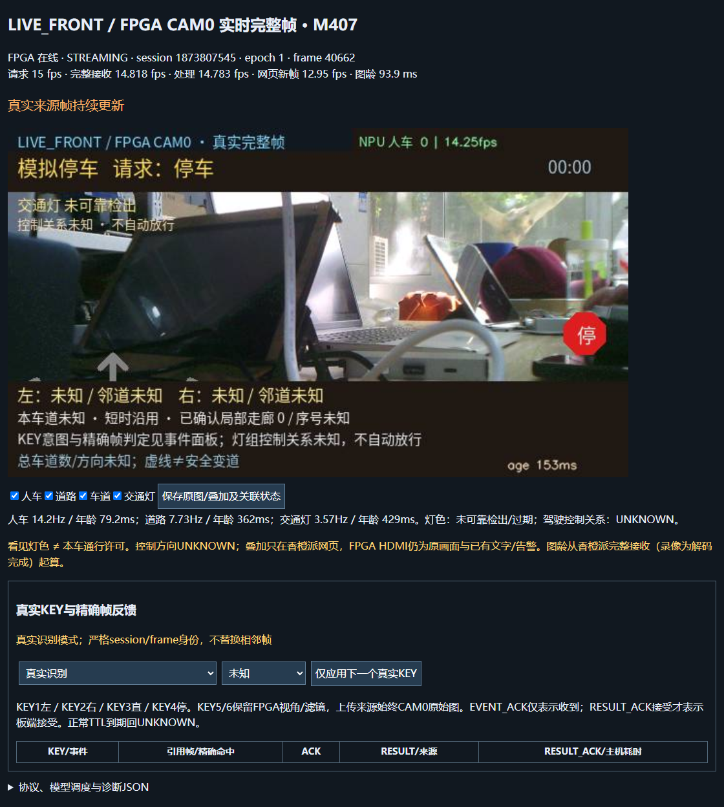
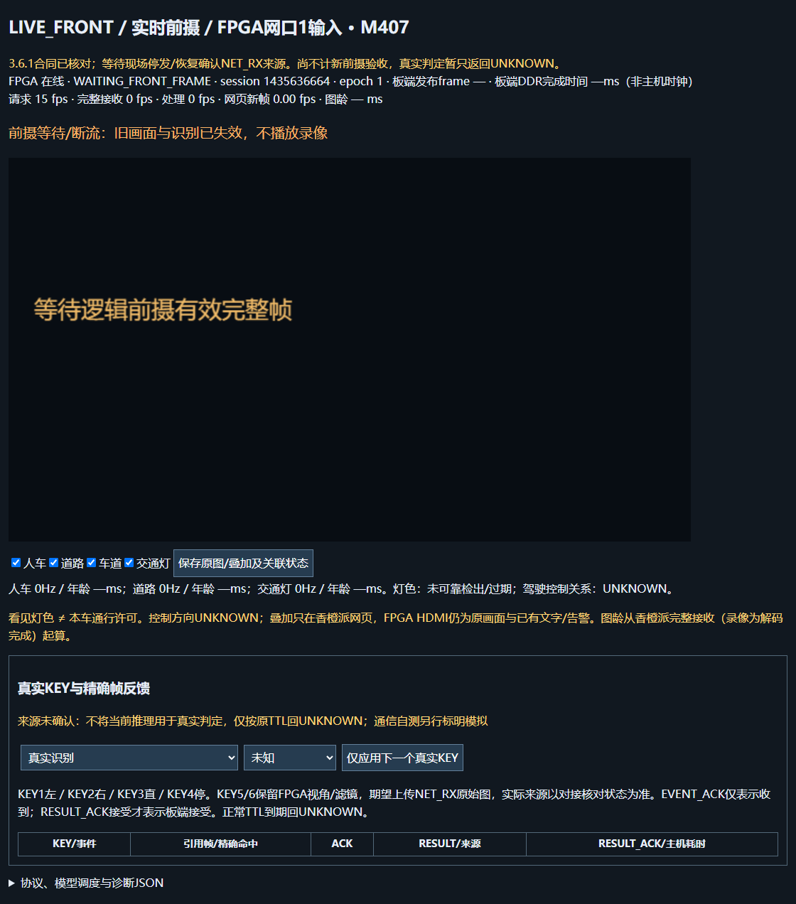
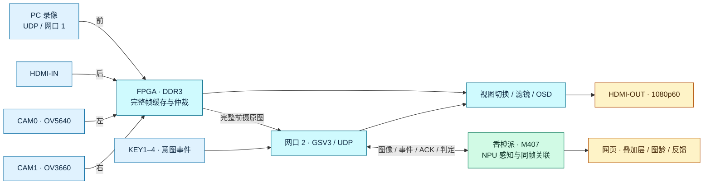

<div align="center">

# FPGA_2026 · 四路视觉 ADAS 原型

**四路视频进一块板，一路原图送上位机，按键事件沿原路闭环。**

紫光同创 MES50HP · Verilog RTL · DDR3 · 双千兆网口 · HDMI · 香橙派 NPU

[作品演示](#作品演示) · [系统架构](#系统架构) · [快速开始](#快速开始) · [版本与验证](#版本与验证) · [仓库导航](#仓库导航)


<sub>作品演示实拍 · FPGA 采集与显示主板</sub>

</div>

> **当前 GitHub 归档范围**：已发布工程源码、核心冻结发布、开发资料和代表性实拍。受首轮大包传输中断影响，部分历史二进制、证据及大体积媒体仍仅保存在本地；本分支不是完整开发机备份。

## 项目概览

这是一个用于竞赛和台架联调的辅助驾驶视觉原型。FPGA 接入两路摄像头、一路 HDMI 和一路网口视频，负责帧缓存、视图切换、滤镜、OSD 和显示；香橙派接收逻辑前摄原图，运行人车、道路及交通灯感知，在网页显示叠加结果，并对带帧引用的按键事件给出反馈。

| **4 路输入** | **2 条网络链路** | **1080p60 HDMI** | **1 条原图感知链** |
| :---: | :---: | :---: | :---: |
| 双 DVP 摄像头 + HDMI + UDP | PC → FPGA；FPGA ↔ 香橙派 | 单视图、四宫格、滤镜与 OSD | 显示滤镜不改变送往识别端的原图 |

## 作品演示

[完整作品介绍（2 分 46 秒）](视频/作品介绍/作品介绍.repo.mp4) · [四路画面与滤镜](视频/四路视频流输入和滤镜.mp4) · [按键与 LED](视频/按键及LED灯显示.mp4) · [上位机处理](视频/上位机处理展示.mp4)

### 四路画面：从单视图切到四宫格

`KEY5` 循环选择前、后、左、右或四宫格；`KEY6` 切换原图、灰度、彩色均值、二值和分量显示。变化发生在 FPGA 显示支路，不应改变原图上传支路。

| 四宫格原彩画面 | 四宫格二值效果 |
| --- | --- |
|  |  |

### 从按键、LED，到对应帧的网页反馈

`KEY1` 到 `KEY4` 模拟左、右、直行和停车意图。板端显示按键状态，香橙派网页按会话和帧号关联事件、推理与 ACK。接收确认不等于板端已接受判定；没有同帧证据时返回 `UNKNOWN`。

| 板载按键与 LED | 香橙派录像回放与感知叠加 |
| --- | --- |
|  |  |

<details>
<summary>查看 M407 实时页与断流状态</summary>

| 历史 CAM0 实时预览 | 3.6.1 候选等待有效 NET_RX 帧 |
| --- | --- |
|  |  |

这两张截图来自不同联调阶段。历史 CAM0 画面不能作为 3.6.1 网口前摄实物闭环的验收依据。[配图与视频来源](docs/readme/README.md)

</details>

## 系统架构

下面是 **3.6.1 SOURCE_MAP** 候选的逻辑映射。旧位流可能使用不同的输入方位和上传源，请按对应版本的清单确认。



| 数据链 | 实现与边界 |
| --- | --- |
| 视频与显示 | 四路输入进入 DDR3 帧缓存；四宫格顺序为前 / 后 / 左 / 右，按从左到右、从上到下排列。 |
| 前摄上传 | 3.6.1 从网口 1 接收逻辑前摄，再由网口 2 转发 `1280×720 RGB565` 完整帧。断流后清理失效画面，不偷换成 CAM0。 |
| 感知与反馈 | 香橙派网页可叠加人车、道路、车道和交通灯状态；检测框与道路遮罩不直接显示在 FPGA HDMI 上。 |

## 快速开始

### 1. 克隆并选择版本

```powershell
git clone https://github.com/yuhuang007/FPGA_2026.git
Set-Location FPGA_2026
```

- **只看作品**：直接查看[四路画面与滤镜](视频/四路视频流输入和滤镜.mp4)和[配图说明](docs/readme/README.md)，不需要开发板。
- **只核对位流**：打开 [3.6.1 冻结发布](FPGA_GS/FPGA_GSV1/release/FPGA_GSV1_SOURCE_MAP_3_6_1_CANDIDATE)，对照 `artifact.json` 校验 `.sbit` 的 SHA-256。
- **使用硬件联调**：准备 MES50HP（PGL50H-6IFBG484）、对应摄像头、HDMI 显示设备、香橙派和两条独立有线链路。先读 [3.6.1 操作说明](FPGA_GS/FPGA_GSV1/docs/网口前摄视频发送操作_3.6.1.md)，核对网口、业务地址和当前位流后，再启动 PC 视频发送和 M407。可选[日间样片](FPGA_GS/SC/SC_BT.mp4)、夜间样片（本地），或先使用测试图案。

### 2. 从冻结源码构建 FPGA

Windows 上准备 PowerShell 7、Python 和自行合法安装并授权的 Pango Design Suite 2022.2-SP6.4。下方路径是示例，换成实际的 `pds_shell.exe`。

```powershell
Set-Location FPGA_GS/FPGA_GSV1/release/FPGA_GSV1_SOURCE_MAP_3_6_1_CANDIDATE/source
pwsh -File ./scripts/build_source_map.ps1 -Pds 'C:\PDS\bin\pds_shell.exe'
```

脚本输出 `build/` 下的构建结果、时序和候选位流，不会自动下载或固化 Flash。历史脚本和文档中的旧盘符、FFmpeg 路径、串口号与香橙派配置需要按实际设备核对。

## 版本与验证

| 入口 | 适合做什么 | 已记录的验证边界 |
| --- | --- | --- |
| [3.6.1 SOURCE_MAP](FPGA_GS/FPGA_GSV1/release/FPGA_GSV1_SOURCE_MAP_3_6_1_CANDIDATE/artifact.json) | 网口录像作为逻辑前摄；按冻结源码重建 | 有构建、定向检查和已声明约束的 STA 记录；不是完整实物验收。 |
| [3.5.9-R0 READBACK](FPGA_GS/FPGA_GSV1/release/FPGA_GSV1_CAM0_OV5640_3_5_9_READBACK/README.md) | 保持原曝光，对 CAM0 进行基线读回 | 只读诊断候选；不代表拖影修复。 |
| [M407 上位机](FPGA_GS/FPGA_GSV1/orangepi/m407) | 实时页、录像对照、精确帧匹配与反馈 | 历史 CAM0 有实流记录；3.6.1 使用 NET_RX 时应单独做来源与停发恢复核验。 |
| [M2.02 历史基线](FPGA_GS/FPGA_GSV1/docs/M2_02_board_test.md) | 回看 800×480 三路显示与滤镜验收方法 | 属于旧版显示配置，不能替代 3.6.1 的接线和验收。 |

**使用边界：** 这是台架和竞赛演示原型。按键只是驾驶意图模拟，识别结果不用于控制实车；看到灯色也不代表本车道可通行。

## 仓库导航

| 内容 | 从这里开始 |
| --- | --- |
| FPGA 工作树 | [RTL](FPGA_GS/FPGA_GSV1/rtl) · [工程脚本](FPGA_GS/FPGA_GSV1/scripts) · [仿真](FPGA_GS/FPGA_GSV1/sim) · [约束](FPGA_GS/FPGA_GSV1/constraints) |
| 冻结版本、候选与实验 | [Release](FPGA_GS/FPGA_GSV1/release) · [Work](FPGA_GS/FPGA_GSV1/work) · [验证报告](FPGA_GS/FPGA_GSV1/reports) |
| 上位机和训练实验 | [香橙派工程](FPGA_GS/FPGA_GSV1/orangepi) · [M4 链路契约](FPGA_GS/FPGA_GSV1/docs/M4_link_contract.md) · [交通灯训练](FPGA_GS/FPGA_GSV1/orangepi/pc_traffic_20261024) |
| 开发文档和参考资料 | [项目总交接](FPGA_GS/FPGA_GSV1/docs/handoff/20261024/项目总交接.md) · [ADAS 开发文档](docs/比赛开发文档_ADAS.md) · [板卡资料](资料) · [早期实验](JF) |
| 媒体与归档范围 | [作品视频](视频) · [入库说明](docs/readme/repository-scope.md) |

本仓库优先保留源码、冻结发布、报告和复现入口，不包含完整远端板端环境。第三方模型、板卡资料及 IP 的许可，以各自原有声明为准。
