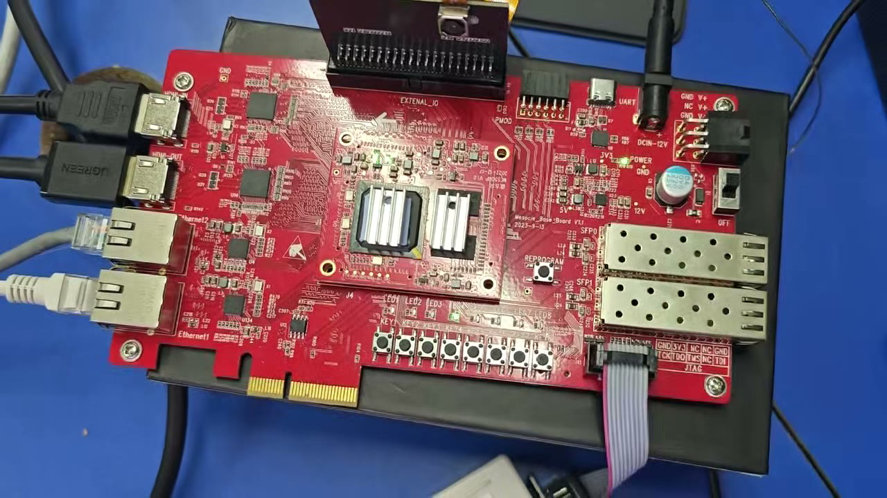
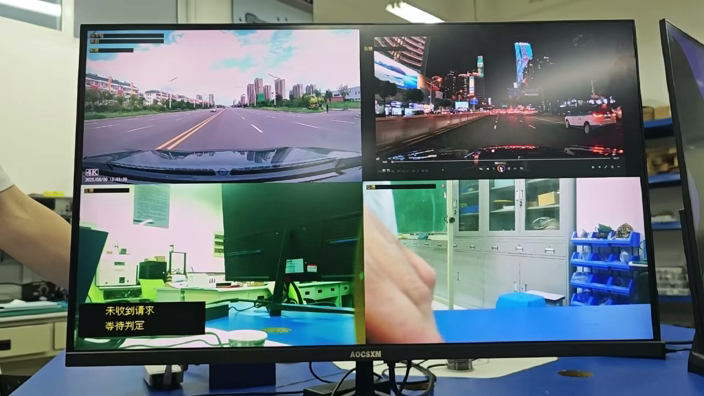
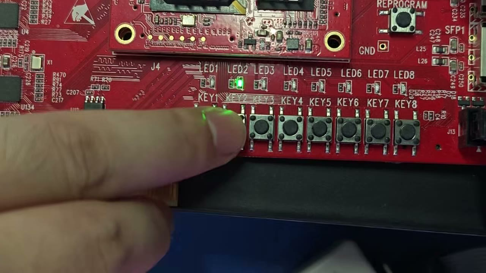
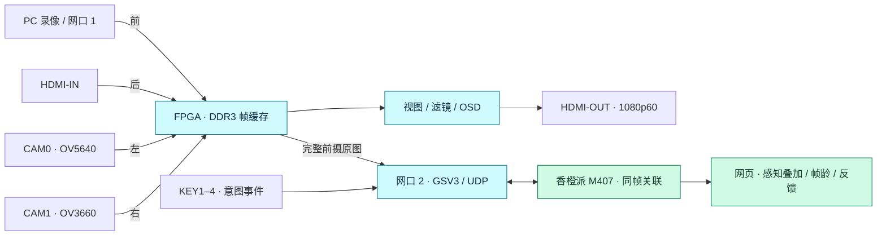

<div align="center">

# FPGA_2026 · 四路视觉 ADAS 原型

**四路视频进一块板，一路原图送上位机，按键事件沿原路闭环。**

MES50HP · Verilog RTL · DDR3 · 双网口 · HDMI · 香橙派 NPU

[作品演示](#作品演示) · [数据路径](#数据路径) · [复现入口](#复现入口)



</div>

> **核心工程归档**：本分支优先发布 RTL、约束、仿真、两套冻结源码与位流、香橙派应用源码和代表性演示。全量历史目录、模型数据及大体积视频不在这个核心版本中。

## 作品演示

[四路视频与滤镜实拍](视频/四路视频流输入和滤镜.mp4) · [按键与 LED 实拍](视频/按键及LED灯显示.mp4)

| 原彩四宫格 | 二值四宫格 |
| --- | --- |
|  |  |

| 按键与 LED | 香橙派录像回放 |
| --- | --- |
|  |  |

`KEY5` 切换视图，`KEY6` 切换显示滤镜；`KEY1–4` 用于模拟左、右、直行和停车意图。上位机叠加图为历史录像回放，不是 3.6.1 实物联调的验收证明。

## 数据路径



以上是 **3.6.1 SOURCE_MAP 候选**的逻辑映射。FPGA 显示滤镜不改变上传的前摄原图；香橙派识别叠加不直接显示在 FPGA HDMI 上。没有对应帧或来源未确认时，判定保持 `UNKNOWN`。

## 复现入口

| 项目 | 入口 |
| --- | --- |
| FPGA 冻结发布 | [3.6.1 SOURCE_MAP 候选](FPGA_GS/FPGA_GSV1/release/FPGA_GSV1_SOURCE_MAP_3_6_1_CANDIDATE) · [3.5.9-R0 CAM0 读回候选](FPGA_GS/FPGA_GSV1/release/FPGA_GSV1_CAM0_OV5640_3_5_9_READBACK) |
| FPGA 开发 | [RTL](FPGA_GS/FPGA_GSV1/rtl) · [仿真](FPGA_GS/FPGA_GSV1/sim) · [约束](FPGA_GS/FPGA_GSV1/constraints) |
| 软硬件联调 | [3.6.1 操作说明](FPGA_GS/FPGA_GSV1/docs/网口前摄视频发送操作_3.6.1.md) · [M407 上位机](FPGA_GS/FPGA_GSV1/orangepi/m407) · [链路契约](FPGA_GS/FPGA_GSV1/docs/M4_link_contract.md) |
| 工程说明 | [ADAS 开发文档](docs/比赛开发文档_ADAS.md) · [项目总交接](FPGA_GS/FPGA_GSV1/docs/handoff/20261024/项目总交接.md) |

准备 Windows、PowerShell 7、Python 和合法安装授权的 Pango Design Suite 2022.2-SP6.4。使用实际的 `pds_shell.exe` 路径：

```powershell
git clone https://github.com/yuhuang007/FPGA_2026.git
Set-Location FPGA_2026/FPGA_GS/FPGA_GSV1/release/FPGA_GSV1_SOURCE_MAP_3_6_1_CANDIDATE/source
pwsh -File ./scripts/build_source_map.ps1 -Pds 'C:\PDS\bin\pds_shell.exe'
```

构建不自动下载位流。3.6.1 记录了定向仿真和已声明约束的 STA，不代表完整上板验收。此工程仅用于台架与竞赛演示，不控制实车。
